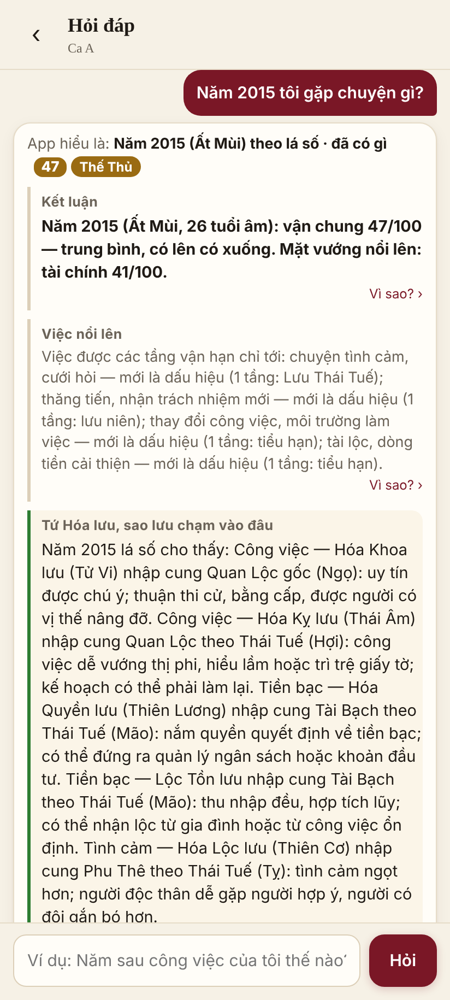
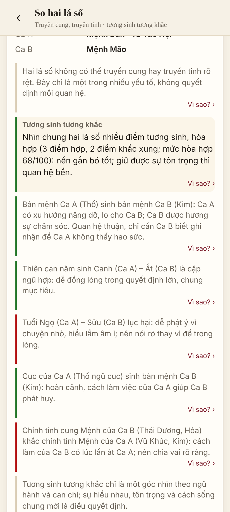
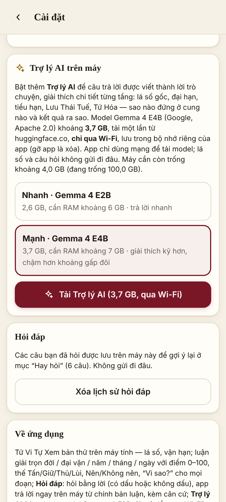

# Báo cáo bản 0.9.0 — Luận chi tiết, việc đã qua, tương sinh tương khắc, Trợ lý AI Nhanh/Mạnh

Ngày 22/11/2026. Quyết định chi tiết: `docs/DECISIONS.md` D-65 … D-68.

## Anh yêu cầu gì, đã làm gì

| Yêu cầu | Kết quả |
| --- | --- |
| Phần luận còn ít, chung chung; cần trả lời chi tiết hơn từng câu hỏi | Mỗi câu trả lời có thêm: **từng sao trong cung** (nghĩa từng sao tại cung đó, sao chiếu về), **cụ thể trong năm** (Tứ Hóa lưu, sao lưu chạm cung nào → dễ xảy ra việc gì), **theo tháng** (tháng nên chủ động / nên giữ), **lời khuyên đúng chủ đề**. Tính cách có thêm bản mệnh – Cục, Thân, Phúc Đức (D-65) |
| Dựa lá số nói ra những việc đã xảy ra khi được hỏi | “Năm 2015 tôi gặp chuyện gì?” → kể lại mặt thuận / vướng, việc nổi lên, Tứ Hóa lưu và sao lưu chạm vào đâu, Tứ Hóa năm vào lĩnh vực nào. “Những mốc quan trọng đã qua?” → các năm có việc lớn, theo thời gian (D-66) |
| Nâng cấp AI ở mức cao nhất | Thêm model **Mạnh: Gemma 4 E4B** (3,7 GB) bên cạnh **Nhanh: Gemma 4 E2B**; người dùng chọn trong thẻ Trợ lý AI. Lời nhắc ưu tiên phần cụ thể, yêu cầu nêu việc cụ thể, tháng, nghĩa sao (D-68) |
| So hai lá số: luận tương sinh tương khắc | Thêm ngũ hành bản mệnh, thiên can và địa chi năm sinh (ngũ hợp, tam hợp, lục hợp, lục xung, lục hại, tương hình), cung Mệnh, Cục, chính tinh Mệnh; mức hòa hợp và cách dung hòa (D-67) |

## 1. Luận chi tiết hơn

Trước khi sửa, mình đọc lại câu trả lời mẫu và thấy:

- Hỏi sức khỏe nhưng lời khuyên lại là “chủ động bàn chuyện cưới hỏi”, “đọc kỹ hợp đồng” (app độn lời khuyên chủ đề khác cho đủ số).
- Câu hỏi “Sức khỏe cần lưu ý gì?” chỉ có hai đoạn.
- Chưa giải thích từng sao, chưa nói cụ thể năm đó dễ gặp chuyện gì.

Bây giờ, ví dụ “Năm sau sự nghiệp của tôi thế nào?” (lá số mẫu Ca A):

- **Từng sao trong cung Quan Lộc (Ngọ):** Tử Vi (miếu) thuộc Âm Thổ, hóa khí Đế Tinh: quyền uy, phúc lộc… Thiên Khôi: quý nhân… Hỏa Tinh (đắc): nóng vội; đắc địa thì nhanh nhạy… Chiếu về cung này: Hóa Quyền, Thiên Việt từ Mệnh (tam hợp)…
- **Cụ thể năm 2027:** Hóa Lộc lưu (Thái Âm) nhập cung Quan Lộc theo Thái Tuế (Hợi): công việc có thêm cơ hội, nguồn thu hoặc dự án mới. Lộc Tồn lưu nhập cung Quan Lộc gốc (Ngọ): thu nhập ổn định hơn… Tang Môn lưu nhập cung Quan Lộc của tiểu hạn (Dậu): công việc dễ có chuyện phiền lòng, cần để ý an toàn khi làm việc nặng.
- **Theo tháng:** nên chủ động ở tháng 2, 7, 11; nên giữ nhịp ở tháng 9, 12; tháng nguyệt hạn vào cung Quan Lộc: tháng 2.
- **Lời khuyên:** “Nhận việc mới, mở rộng quan hệ công việc, chốt các thỏa thuận đang chờ”, “Giữ việc chính, để dành phần dư”… — chỉ về công việc.

Kho câu mới `texts/chi_tiet.json` (sinh từ `tools/kb/kb_chitiet.py`): 7 chủ đề × 11 tác nhân (Hóa Lộc, Quyền, Khoa, Kỵ lưu;
Lộc Tồn, Thiên Mã, Kình Dương, Đà La lưu; nhóm Đào Hồng Hỷ; Tang Môn – Bạch Hổ; Thiên Khốc – Thiên Hư), mỗi ô một câu “dễ
xảy ra gì” và một câu “nên làm gì”. Câu nào cũng qua `KbLint` (không phán chắc, không từ cấm).

## 2. Hỏi việc đã xảy ra

- **“Năm 2015 tôi gặp chuyện gì?”** (lá số mẫu Ca A): vận chung 47/100; mặt vướng: tài chính 41/100. Lá số cho thấy năm
  đó: Hóa Khoa lưu (Tử Vi) nhập Quan Lộc gốc — uy tín được chú ý; Hóa Kỵ lưu (Thái Âm) nhập Quan Lộc theo Thái Tuế — công
  việc dễ vướng thị phi; Hóa Lộc lưu (Thiên Cơ) nhập Phu Thê theo Thái Tuế — tình cảm ngọt hơn… Tứ Hóa năm Ất: Hóa Lộc vào
  Điền Trạch (nhà cửa) — thuận; Hóa Kỵ vào Tử Tức (con cái) — vướng… Kèm tháng nổi bật và lời nhắc đối chiếu với việc thật.
- **“Những mốc quan trọng đã qua của tôi?”**: dò 2004–2025, liệt kê 2006 (đi xa — khả năng cao), 2008 (tình cảm, cưới hỏi
  — khả năng cao), 2012 (con cái — có thể), 2016 (thăng tiến — có thể)… Có thể hỏi theo một chủ đề: “Những năm biến động
  lớn trong tình duyên của tôi?”.
- Năm đã qua thì giọng kể lại (“lá số cho thấy”), không kèm lời khuyên.

## 3. So hai lá số: tương sinh tương khắc

Ví dụ Ca A (nam 1990) và Ca B (nữ 1985): nhiều điểm tương sinh, hòa hợp (3 điểm hợp, 2 điểm khắc xung; mức hòa hợp 68/100).
Bản mệnh Thổ sinh Kim; can Canh – Ất ngũ hợp; tuổi Ngọ – Sửu lục hại (nên nói rõ thay vì để trong lòng); Cục Thổ của Ca A
sinh bản mệnh Ca B; chính tinh Mệnh của Ca B (Thái Dương, Hỏa) khắc chính tinh Mệnh Ca A (Vũ Khúc, Kim). Câu khắc nào cũng
kèm cách dung hòa; khi bản mệnh khắc nhau app nêu hành trung gian.

## 4. Trợ lý AI: Nhanh / Mạnh

- **Mạnh — Gemma 4 E4B** (`litert-community/gemma-4-E4B-it-litert-lm`, Apache 2.0, không gated, 3,66 GB, ghim commit và
  SHA-256): giải thích kỹ hơn, cửa sổ 6.144 token, dữ kiện tới 10.500 ký tự, câu trả lời tới 560 chữ. Cần RAM khoảng 7 GB
  (S22 Ultra đủ).
- **Nhanh — Gemma 4 E2B** (2,6 GB) như trước.
- Vì sao chưa lớn hơn nữa: model cỡ hàng chục GB không vừa RAM điện thoại; fine-tune vẫn không làm được (D-62). E4B là bản
  lớn hơn trong cùng họ Gemma 4, đã có sẵn dạng LiteRT-LM và còn vừa RAM của S22 Ultra.

### Chấm 40 câu (model thật, CPU 4 nhân máy build)

Chi tiết: [E2B](tai-ve/ai-cham-40-cau.md) · [E4B](tai-ve/ai-cham-40-cau-e4b.md). Bộ câu thay một câu trùng bằng “Năm 2015 tôi
gặp chuyện gì?”.

| Model | Qua kiểm tra | Trung vị / lâu nhất | Độ dài trung vị | Câu nêu tháng cụ thể |
| --- | --- | --- | --- | --- |
| E2B, bản 0.8.0 | 39/40 | 20,0 / 28,8 giây | — | — |
| E2B, bản 0.9.0 | **37/40** | 26,2 / 36,2 giây | 324 chữ | 17 |
| E4B, bản 0.9.0 | **36/40** | 44,3 / 64,1 giây | 284 chữ | 23 |

- Dữ kiện nay dài và nhiều sao hơn, nên model dễ gán sao sai cung hơn; `AiGuard` bắt hết các câu đó (câu trượt thì app hiện
  bản luận của app). Hai lỗi kiểm tra quá chặt đã sửa: đoạn “Từng sao trong cung X (chi)” và đoạn lá số gốc nay được hiểu là
  sao của cung đó; model quên đóng chuỗi JSON thì vẫn đọc được (nội dung vẫn kiểm đủ).
- Thời gian trên là CPU máy build, chưa phải điện thoại. Trên S22 Ultra (GPU hoặc CPU) có thể nhanh hay chậm hơn; anh đo
  giúp mình khi dùng.

Câu E4B viết cho “Năm 2015 tôi gặp chuyện gì?” (lá số E, nam 1988), qua kiểm tra:

> Chào bạn, dựa trên lá số của bạn, năm 2015 (Ất Mùi) là một năm có vận chung ở mức 53/100… Về mặt công việc, năm đó bạn
> dễ được trao thêm quyền hạn hoặc nhận thêm trách nhiệm quản lý… nhờ Hóa Quyền lưu (Thiên Lương) nhập cung Quan Lộc gốc.
> Tuy nhiên, cũng có thể bạn cảm thấy tâm trạng chùng xuống vì công sức chưa được ghi nhận, do Thiên Khốc lưu nhập cung Quan
> Lộc theo Thái Tuế. Về tiền bạc… Hóa Lộc lưu (Thiên Cơ) nhập cung Tài Bạch và Lộc Tồn lưu… Về tháng, tháng thuận nhất là
> tháng 7, tháng 1 và tháng 11…

## Kiểm thử tại chỗ (`bash tools/setup/test_all.sh`)

| Bước | Kết quả |
| --- | --- |
| Gradle test | 893/893 (`:core:calendar` 25, `:core:engine` 316, `:core:interpret` 552 — thêm test luận chi tiết, việc đã qua, tương sinh tương khắc, hai model AI, đọc JSON lỏng) |
| Build APK | Đạt, ký khóa thật (SHA-256 86:C7:ED…98:C6) |
| Giao diện (`test_ui.py`) | 711/711 — thêm bước 0.9.0: từng sao, cụ thể trong năm, theo tháng, năm 2015, các mốc, chọn model Nhanh/Mạnh, tương sinh tương khắc |
| Selftest trên máy tính | 523/523 + bước gõ câu hỏi |

Ảnh chuẩn giao diện cập nhật có chủ đích: so hai lá số, thẻ Trợ lý AI (ô chọn model), các màn Hỏi đáp có câu trả lời dài hơn.

## Máy ảo Android (CI)

(điền sau khi workflow chạy xong)

## Việc còn lại

- Anh đo tốc độ hai model trên S22 Ultra (GPU/CPU) và cho mình biết model nào anh thích hơn để đặt mặc định.
- Đồng bộ Firebase (D-53) vẫn cần `google-services.json` từ dự án Firebase của anh.
